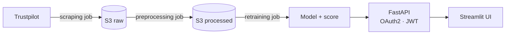

<picture>
  <source media="(prefers-color-scheme: dark)" srcset="assets/header-dark.svg">
  
</picture>

  
  
  

I'm a **Machine Learning Engineer** who takes models past the notebook: reliable data pipelines, reproducible training, and services that run in production.
Before ML, I was a **biology engineer** — I still work like a scientist: clear hypotheses, honest evaluation, results you can reproduce.

## Focus

| Area | What I do |
|---|---|
| **Data pipelines** | Collection, cleaning and feature engineering as versioned, scheduled jobs |
| **Modelling** | Classical ML and NLP, with evaluation that reflects the real use case |
| **Serving** | Secure REST APIs around models, with logging and a lightweight UI |
| **MLOps** | Containerised workflows, CI/CD and automated retraining on fresh data |

## Featured work

### [Sentiment Analysis — end-to-end MLOps](https://github.com/fredevcode/MLOps_SentimentAnalysis)

A production-style system that scrapes Trustpilot reviews, retrains a sentiment model on schedule and serves predictions behind an authenticated API.

- **4 independent Docker jobs** — scraping, preprocessing, retraining and API — each triggered by its own GitHub Actions workflow
- **Automated retraining** on reviews stored in S3, with the model score saved alongside each version
- **Continuous delivery** — the API image is built, pushed to Docker Hub and deployed on every release
- **Stack** — Python · scikit-learn · NLTK · pandas · FastAPI · Streamlit · Docker · AWS S3

## Tech stack

  

- **ML & data** — Python, scikit-learn, pandas, NumPy, NLTK, SQL
- **Serving** — FastAPI, Streamlit, REST
- **MLOps & infra** — Docker, docker-compose, GitHub Actions, AWS S3, Linux
- **Product** — TypeScript, React, Next.js

## Get in touch

Happy to talk about ML engineering, MLOps or a project you're building.
The fastest way to reach me is [LinkedIn](https://www.linkedin.com/in/fredericnavez/).
