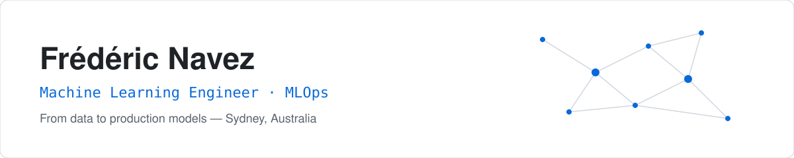
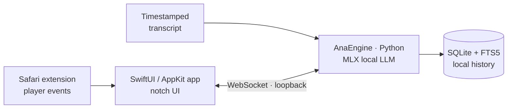
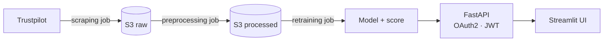

<picture>
  <source media="(prefers-color-scheme: dark)" srcset="assets/header-dark.svg">
  
</picture>

  
  
  

I'm a **Machine Learning Engineer** who takes models past the notebook: reliable data pipelines, reproducible training, and services that run in production.
Before ML, I was a **biology engineer** — I still work like a scientist: clear hypotheses, honest evaluation, results you can reproduce.

## Focus

| Area | What I do |
|---|---|
| **Data pipelines** | Collection, cleaning and feature engineering as versioned, scheduled jobs |
| **Modelling** | Classical ML, computer vision, NLP and local LLMs, with evaluation that reflects the real use case |
| **Serving** | Secure REST APIs around models, with logging and a lightweight UI |
| **MLOps** | Containerised workflows, CI/CD and automated retraining on fresh data |

## Featured work

### Ana — on-device learning assistant for macOS
Private · in active development

A native macOS assistant that helps people understand YouTube lessons in Safari, **with no prompt and no cloud**.
It follows player signals (rewinds, pauses, captions on), aligns them with the timestamped transcript, and offers a short, faithful explanation of the hard passage through an analogy from a domain the learner picked.

- **100 % local inference** with MLX on Apple Silicon (Qwen2.5 family) — prompts, transcripts and history never leave the Mac
- **Native app + engine split** — SwiftUI/AppKit client owns the UI and an embedded Python runtime; the engine owns the model and storage
- **Model evaluation before shipping** — helpers are gated on quality checks; larger 7B/14B candidates were calibrated and rejected when they did not stay faithful to the passage
- **Engineering discipline** — spec-first stories, architecture decision records, typed Python (mypy) and pytest
- **Stack** — Swift · SwiftUI · AppKit · Python · MLX · WebSocket · SQLite/FTS5 · Safari Web Extension

### [PYnt of Blood — blood cell classification](https://github.com/fredevcode/PyntOfBlood/tree/master)

Computer vision project where my biology background meets ML: classifying **8 types of white blood cells** from microscopy images, a first step toward helping detect leukaemia. 6-week team project.

- **Data** — 17,092 labelled images (Barcelona Mendeley dataset), class imbalance analysed, plus an external dataset kept aside as a real-world test set
- **Classical ML baseline** — PCA (70/80/90 % variance) + Random Forest, KNN, logistic regression, voting classifier
- **Deep learning** — CNNs from scratch and transfer learning (VGG16, DenseNet121, EfficientNet, Inception V3) in TensorFlow/Keras
- **Key finding** — models reaching > 0.99 validation accuracy collapsed on the external dataset: a clear case of **domain shift** between microscopy sources, documented in the final report
- **Delivery** — EDA, final report and a Streamlit app to explore data and predictions

| Approach | Result |
|---|---|
| Random Forest on PCA features | 0.76 accuracy (8 classes, chance = 0.125) |
| CNN from scratch | 0.99 validation accuracy on the source dataset |
| Same CNN on external images | 0.07 accuracy → generalisation gap identified |

### [Sentiment Analysis — end-to-end MLOps](https://github.com/fredevcode/MLOps_SentimentAnalysis)

A production-style system that scrapes Trustpilot reviews, retrains a sentiment model on schedule and serves predictions behind an authenticated API.

- **4 independent Docker jobs** — scraping, preprocessing, retraining and API — each triggered by its own GitHub Actions workflow
- **Automated retraining** on reviews stored in S3, with the model score saved alongside each version
- **Continuous delivery** — the API image is built, pushed to Docker Hub and deployed on every release
- **Stack** — Python · scikit-learn · NLTK · pandas · FastAPI · Streamlit · Docker · AWS S3

## Tech stack

  

- **ML & data** — Python, scikit-learn, TensorFlow/Keras, MLX, pandas, NumPy, NLTK, SQL
- **Computer vision & NLP** — CNNs, transfer learning, text classification, local LLMs
- **Serving** — FastAPI, Streamlit, REST, WebSocket
- **Native apps** — Swift, SwiftUI, AppKit
- **MLOps & infra** — Docker, docker-compose, GitHub Actions, AWS S3, Linux
- **Product** — TypeScript, React, Next.js

## Get in touch

Happy to talk about ML engineering, MLOps or a project you're building.
The fastest way to reach me is [LinkedIn](https://www.linkedin.com/in/fredericnavez/).
